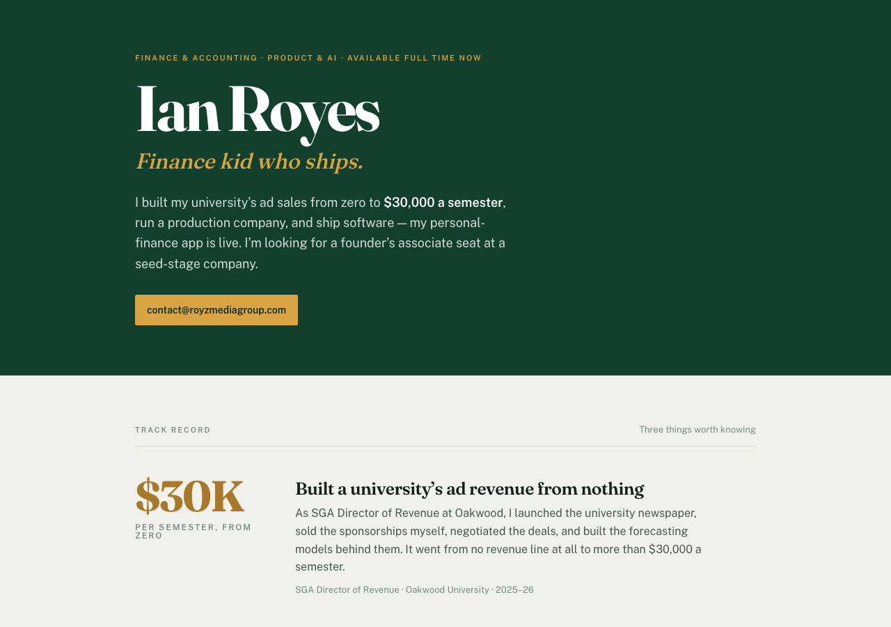

# ianroyes-portfolio

Ian Royes's one-page portfolio and résumé, written for a seed-stage founder deciding in about fifteen seconds whether to reply. Live at [ianroyes.vercel.app](https://ianroyes.vercel.app).



## Why it looks like this

The page has one reader and one job: a founder skimming on a phone. So it leads with three numbers instead of a list of twenty projects, stays under roughly 450 words, and ships as static HTML with no build step so it loads instantly on mobile.

## Features

- **"Track Record" layout**: the figures are the main visual element, set in Fraunces on a deep pine ground with brass numerals.
- **Printable résumé** at [`/resume.html`](https://ianroyes.vercel.app/resume.html), styled to match and laid out for a single printed page.
- **App support pages** for Ian's personal iOS app under `/ianroyz-app/` (privacy policy and support), as required by App Store review.
- **Remote config** at `/app/ianroyz-live.json` that the same iOS app reads for its marquee and weekly prompt, so copy can change without an app update.
- No JavaScript framework, no tracking, no dark mode on purpose: it's a document.

## Tech stack

Static HTML and CSS, Google Fonts (Fraunces, Public Sans), deployed on Vercel.

## Getting started

```sh
python3 -m http.server 4830
# open http://localhost:4830
```

Deploy with the Vercel CLI: `vercel deploy --prod`.

## Project structure

```
index.html            the portfolio page
resume.html           one-page résumé
ianroyz-app/          privacy and support pages for the IAN ROYZ iOS app
app/ianroyz-live.json remote config read by that app
docs/                 README screenshot (excluded from deploys)
```

## Status

Live at [ianroyes.vercel.app](https://ianroyes.vercel.app).

Built by [Ian Royes](https://github.com/ianroyes-sys)
